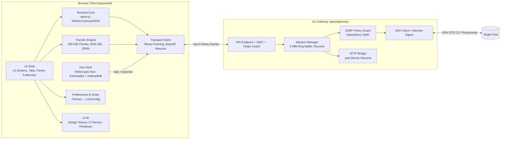

# WebSSH Studio

Production-grade, browser-based SSH terminal and SFTP workspace with non-extractable WebCrypto keys, remote-signer SSH authentication, credit-based binary WebSocket multiplexing, resumable 256 KiB chunked file transfers, and a companion Go 1.22+ gateway.

## High-Level Overview

- **Zero-Trust Browser Key Vault (`apps/web/src/vault`)**: Generates Ed25519 (with ECDSA P-256 fallback) key pairs as **non-extractable** WebCrypto `CryptoKey` objects stored in IndexedDB and wrapped with AES-256-GCM. Private keys never leave the browser.
- **Remote-Signer SSH Handshake (`apps/gateway/internal/sshbridge`)**: The Go gateway dials target SSH hosts (including multi-hop `ProxyJump` chains) and forwards SSH `publickey` signature challenges (`sign_request`) over the binary WebSocket control channel to the browser (`sign_response`), converting WebCrypto IEEE-P1363 signatures to OpenSSH `mpint` wire format.
- **Persistent Sessions & Auto-Reconnect (`apps/web/src/transport`, `apps/gateway/internal/session`)**: Exponential backoff (`500 ms` -> `30 s`, `±25%` jitter), a 64 KiB client pending-input queue, and a 4 MiB per-session gateway ring buffer ensure zero lost output across network drops, with optional `tmux` auto-attach.
- **Bounded Memory SFTP & File Manager (`apps/web/src/files`)**: Dual-pane SFTP browser, drag-and-drop file and recursive folder upload, 256 KiB chunked streaming with incremental SHA-256 verification, `.part` atomic rename and offset resume, streaming ZIP/ZIP64 folder downloads, tabbed remote file editor, and `StorageGuard` quota enforcement.
- **Token-Driven Design System (`packages/ui-kit`, `/design`)**: 9 accessible themes (Dark, Light, High-Contrast, Solarized, Dracula, Nord, Gruvbox, Tokyo Night, One Dark), custom 16-color ANSI editor with live WCAG AA contrast verification, immersive chrome-free full-screen mode (`F11` / `Cmd/Ctrl+Shift+F`) with top-edge hover overlay and iOS `100dvh` fallback, Zen mode, Command Palette (`Cmd/Ctrl+K`), snippets, broadcast input, and asciicast v2 session recording/replay.

## Architecture



## Milestone Checklist Status

All milestones in [`memory/SESSION_PLAN.md`](./memory/SESSION_PLAN.md) and [`docs/FEATURES.md`](./docs/FEATURES.md) are complete:
- [x] **Step 0 — Stitch & One-Page Plan** (`/design`, `docs/DECISIONS.md`, `docs/IMPLEMENTATION_PLAN.md`)
- [x] **Step 1 (M0) — Scaffolding & CI** (`.github/workflows/ci.yml`, `pages.yml`, `gateway-release.yml`, `security.yml`)
- [x] **Step 2 (M1) — Design System** (`packages/ui-kit`, `scripts/build-tokens.mjs`, `scripts/lint-tokens.mjs`)
- [x] **Step 3 (M2) — Protocol & Gateway Core** (`packages/protocol`, `apps/gateway/internal/{protocol,policy,auth,audit}`)
- [x] **Step 4 (M3) — Vault & Remote-Signer Auth** (`apps/web/src/vault`, `apps/gateway/internal/sshbridge`)
- [x] **Step 5 (M4) — Workspace, Terminal & Persistence** (`apps/web/src/terminal`, `apps/web/src/transport`, `apps/gateway/internal/session`)
- [x] **Step 6 (M5) — File Transfers** (`apps/web/src/files`, `apps/gateway/internal/sshbridge`)
- [x] **Step 7 (M6) — Customization** (`apps/web/src/prefs`, `apps/web/src/hosts`)
- [x] **Step 8 (M7) — Productivity & Security Extras** (`apps/web/src/ui`, PWA manifest & service worker)
- [x] **Step 9 (M8) — Hardening, Verification & Release** (`deploy/docker`, `deploy/fly`, `e2e/`, `docs/`)

---

## Commands to Run

### 1. Install Dependencies & Build Design Tokens
```bash
npm install
npm run tokens:build
npm run lint:tokens
```

### 2. Typecheck & Build All Packages (`protocol`, `ui-kit`, `web`)
```bash
npm run typecheck
npm run build
```

### 3. Run Unit, Property & Integration Tests
```bash
# Run all TypeScript unit & fast-check property tests (protocol, ui-kit, vault, transport, terminal, files, prefs, hosts, ui)
npm test

# Run Go gateway unit, fuzz, SSRF policy, session ring-buffer, and OpenSSH remote-signer/SFTP integration tests
cd apps/gateway && go test -v -cover ./...
```

### 4. Run Local Development Servers
```bash
# Terminal 1 — Start the Go WebSocket-to-SSH/SFTP Gateway on :8080
cd apps/gateway && ALLOWED_ORIGINS="http://localhost:4173" go run ./cmd/gateway

# Terminal 2 — Start the Vite WebSSH Studio client on http://localhost:4173
npm run dev
```

### 5. Run Cross-Browser Playwright E2E & Axe Accessibility Suite
```bash
npm run test:e2e
```

### 6. Build & Run Hardened Distroless Gateway Container
```bash
docker compose -f deploy/docker/docker-compose.yml up --build
```
